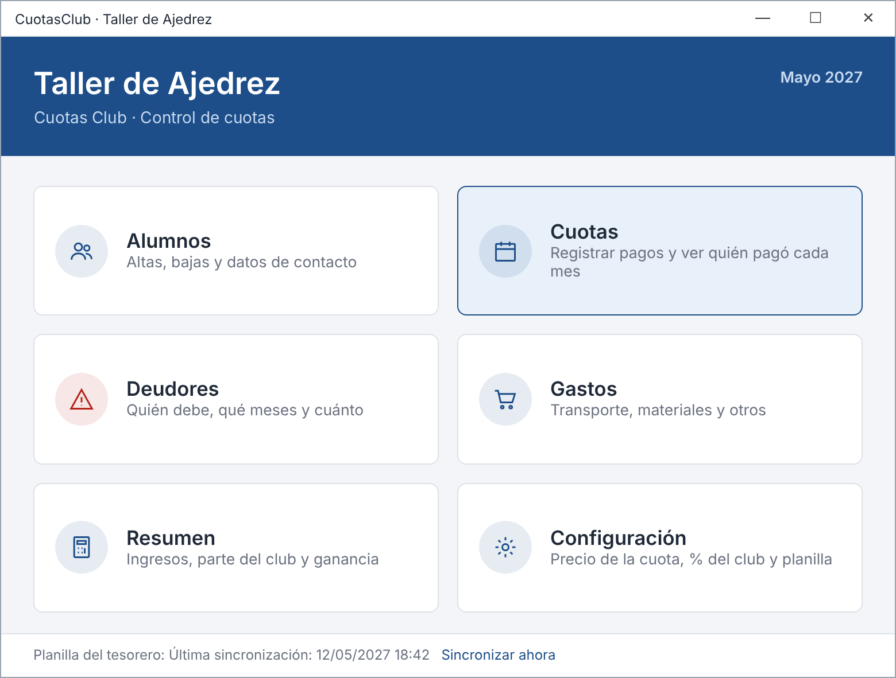
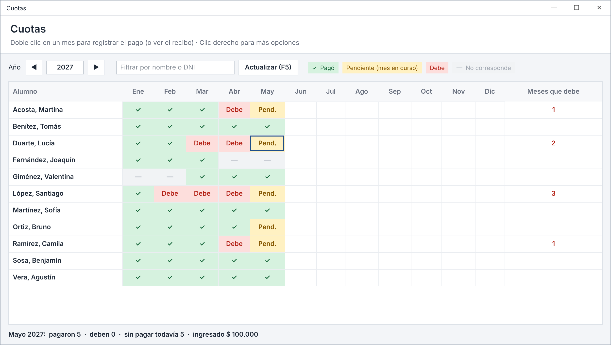
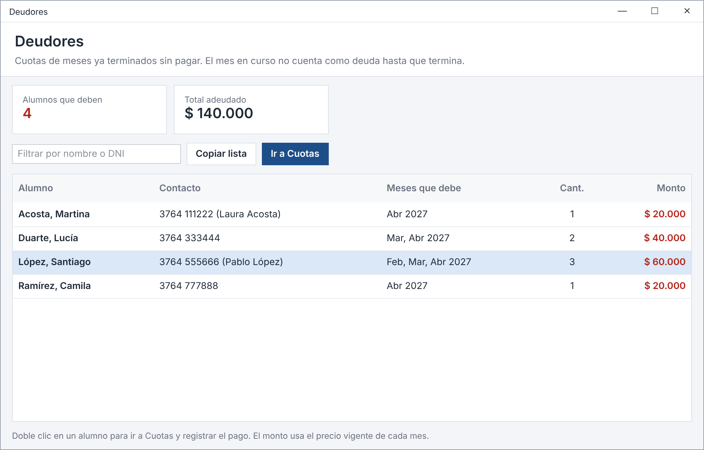
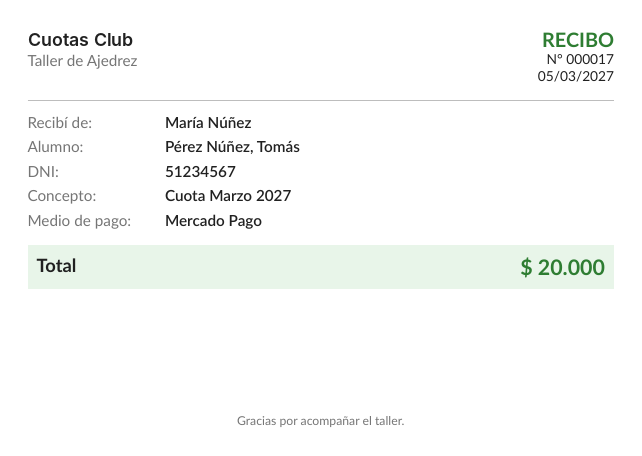

# CuotasClub

**Programa de escritorio para que un profesor lleve las cuotas de las clases que da en un club: quién pagó, quién debe, recibos en PDF, avisos por WhatsApp y una planilla automática para el tesorero.**

Hecho en C# con .NET 10, Windows Forms y SQLite. Nació de una necesidad real: el taller de un club que lo usa todos los meses.



## El problema

Un profesor que da clases en un club cobra una cuota mensual a cada alumno y le entrega al club un porcentaje. Llevarlo en un cuaderno o en una planilla suelta trae siempre los mismos problemas:

- No queda claro quién debe y desde cuándo, sobre todo con alumnos que dejan y vuelven.
- Cuando sube la cuota, se mezclan los precios viejos con los nuevos.
- Hay que hacer recibos a mano y perseguir a los que se atrasan.
- El tesorero del club pide cuentas y hay que armarle un resumen cada vez.

## Qué hace

| | |
|---|---|
| **Alumnos** | Altas, bajas y ausencias (se va y vuelve) sin perder el historial. Para menores guarda el tutor y su teléfono. Búsqueda sin importar acentos ni mayúsculas. |
| **Cuotas** | Grilla anual por alumno con colores: **Pagó**, **Pendiente** (mes en curso), **Debe** (mes vencido). Doble clic para cobrar. |
| **Recibos** | Genera el recibo en PDF y lo deja listo para mandar por **WhatsApp** con un mensaje ya escrito. |
| **Deudores** | Lista de quién debe, qué meses y cuánto, con un botón para mandar un recordatorio amable por WhatsApp. |
| **Gastos y resumen** | Gastos del taller, resumen mensual y anual: ingresos, parte del club y ganancia del profesor. |
| **Planilla del tesorero** | Sube sola a Google Sheets lo que le corresponde al club, sin mostrar gastos ni ganancias. |
| **Copias de seguridad** | Copia automática al cerrar (guarda las últimas 30), que puede ir a Google Drive, y restauración con un clic. |
| **Fácil de instalar** | Instalador sin permisos de administrador y asistente de primer uso: cualquier profesor lo configura para su club sin tocar el código. |



| Deudores | Recibo en PDF |
|---|---|
|  |  |

## Reglas de negocio destacadas

- **El mes en curso no es deuda** hasta que termina: recién el día 1 del mes siguiente pasa a "Debe".
- **Todo es histórico**: cada pago guarda el precio y el porcentaje del club vigentes *en ese mes*. Subir la cuota no cambia lo ya cobrado, y un pago atrasado se cobra al precio de su mes.
- **Ausencias**: los meses en que un alumno no vino no cuentan como deuda.
- **Montos en centavos** (enteros) para evitar errores de redondeo.
- **Un solo pago válido por alumno y mes**, garantizado por la base de datos. Anular no borra: queda en el historial.

## Cómo está hecho

```
src/
  CuotasClub.Core/    Reglas y datos. No depende de Windows: se puede probar sola.
    Models/           Alumno, Pago, Gasto, PrecioCuota...
    Data/             Conexión a SQLite y creación/migración de tablas
    Repositories/     Consultas SQL con parámetros (sin ORM)
    Services/         Cálculo de cuotas, resumen, copias, WhatsApp, planilla
  CuotasClub/         Interfaz Windows Forms, recibos PDF y conexión a Google
tests/
  CuotasClub.Tests/   88 pruebas automáticas (xUnit) con una base SQLite temporal cada una
instalador/           Scripts de instalación (PowerShell) e Inno Setup
```

- **Separación en capas**: toda la lógica vive en `CuotasClub.Core`, y la interfaz solo muestra y pide datos. Por eso las reglas importantes están cubiertas por pruebas.
- **SQLite** como base local: un solo archivo, sin servidor, con migraciones automáticas para que las bases de versiones anteriores se actualicen solas sin perder datos.
- **Funciona sin internet**: la planilla del tesorero queda "pendiente" y se sincroniza en segundo plano cuando hay conexión.
- Librerías: [Microsoft.Data.Sqlite](https://www.nuget.org/packages/Microsoft.Data.Sqlite), [QuestPDF](https://www.questpdf.com/) (recibos), [Google.Apis.Sheets.v4](https://www.nuget.org/packages/Google.Apis.Sheets.v4) (planilla).

## Probarlo

**Como usuario (Windows 10/11):** descargá `Instalar-CuotasClub-1.0.zip` desde la [última versión](https://github.com/medinafrancoalexisfide-collab/CuotasClub/releases/latest) y seguí [docs/INSTALAR.md](docs/INSTALAR.md). No hace falta instalar .NET; arranca vacío y te pide los datos de tu club.

**Como desarrollador:** con el SDK de .NET 10,

```bash
dotnet build CuotasClub.slnx
dotnet test
```

o abrí `CuotasClub.slnx` en Visual Studio 2026 y ejecutá el proyecto `CuotasClub` (el programa necesita Windows; las pruebas corren en cualquier sistema).

## Más documentación

- [Instalar en la PC](docs/INSTALAR.md)
- [Conectar la planilla del tesorero (Google Sheets)](docs/CONECTAR-GOOGLE-SHEETS.md)
- [Notas técnicas y decisiones de diseño](docs/NOTAS-TECNICAS.md)

Las capturas son de demostración, con alumnos ficticios. Ningún dato real de alumnos está en este repositorio: la base de datos y las credenciales de Google quedan solo en la computadora de cada usuario.

## Licencia

[MIT](LICENSE): podés usar, copiar y modificar el código libremente, manteniendo el aviso de autoría.

QuestPDF, la librería de los recibos, se usa con su licencia Community (gratuita para personas y organizaciones chicas).
